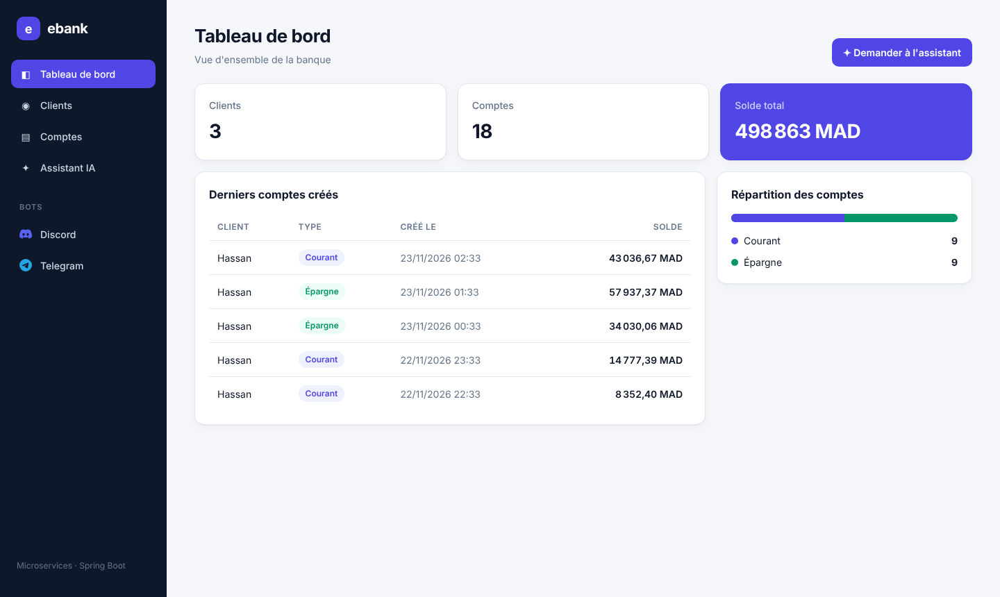
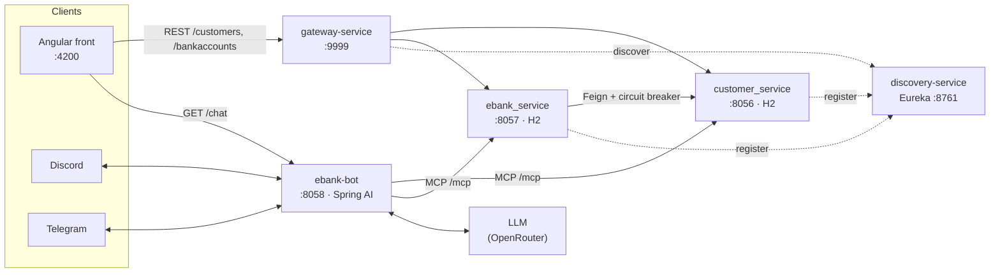
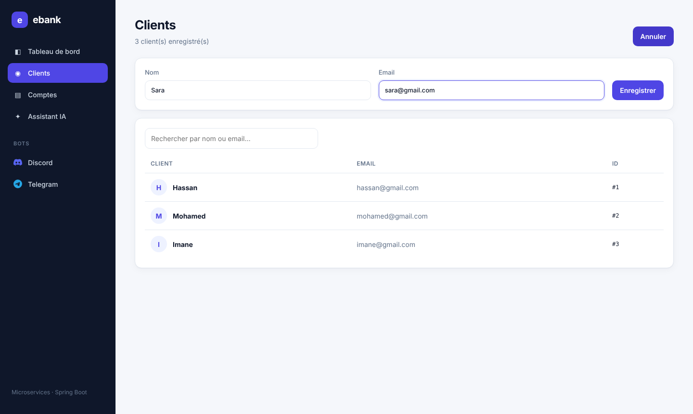
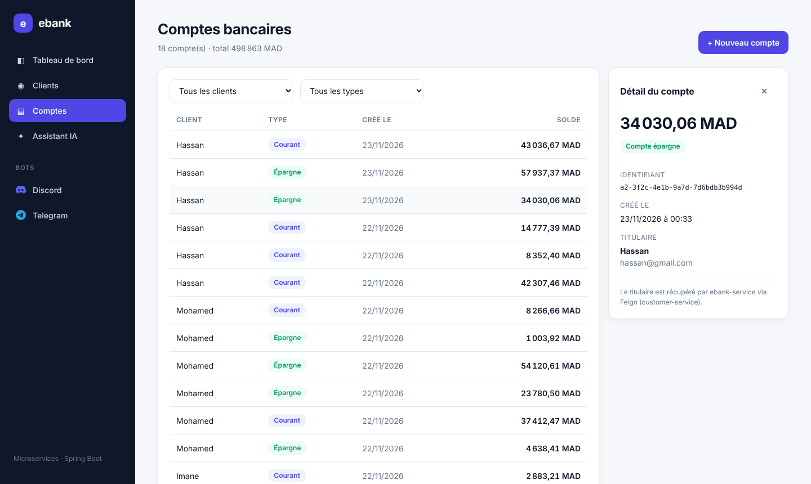
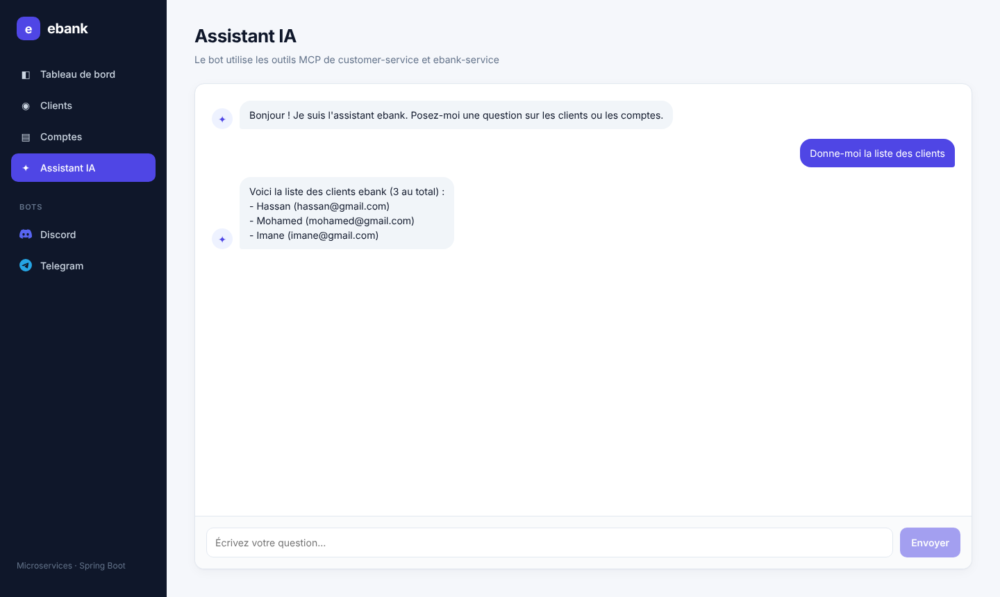

# ebank — Spring Boot microservices with an AI assistant

A small online bank built with **Spring Boot**, **Spring Cloud** and **Spring AI**.
The bank is split into microservices (customers, bank accounts, discovery, gateway), and an **AI agent** can answer questions about customers and accounts by calling the services through **MCP tools**. You can talk to that agent from a web page, from **Discord** or from **Telegram**. An **Angular** frontend gives a dashboard over everything.



---

## Architecture



| Service | Port | Role |
|---|---|---|
| `discovery-service` | 8761 | Eureka server: every service registers here |
| `gateway-service` | 9999 | Spring Cloud Gateway, routes are created from Eureka (`/CUSTOMER-SERVICE/**`, `/EBANK-SERVICE/**`) |
| `customer_service` | 8056 | Customers (id, name, email): REST API + MCP server |
| `ebank_service` | 8057 | Bank accounts (balance, type, owner): REST API + MCP server, calls `customer_service` with OpenFeign and a Resilience4j circuit breaker |
| `ebank-bot` | 8058 | AI agent (Spring AI `ChatClient`, chat memory, MCP client). Exposed over HTTP (`/chat`), Discord and Telegram |
| `ebank-front` | 4200 | Angular 21 web app |

**Tech stack:** Java 17 · Spring Boot 4 · Spring Cloud 2025 · Spring AI 2 (MCP) · Spring Data JPA · H2 · OpenFeign · Resilience4j · JDA (Discord) · TelegramBots · Angular 21

---

## How the AI assistant works

1. A message arrives from the web page, Discord or Telegram.
2. `EbankAiAgent` sends it to the LLM with a system prompt (only bank questions, always use the tools, never invent data, answer in French) and the conversation history.
3. The LLM picks a tool, for example `getAllCustomers`, `findCustomerById`, `saveCustomer`, `getAllBankAccounts`, `getBankAccountById` or `save`.
4. Spring AI calls that tool on `customer_service` or `ebank_service` over **MCP** (`/mcp`, streamable HTTP). These tools are just the service methods annotated with `@McpTool`.
5. The LLM writes the final answer from the real data.

Each conversation keeps its own memory (last 20 messages): one per browser tab, per Discord user and per Telegram chat.

---

## The frontend

### Dashboard
Number of customers and accounts, total balance, latest accounts and the current/saving split.


### Customers
List with search, and a form to add a customer (`POST /customers`).



### Bank accounts
Filter by customer and type, create an account, and click an account to see its details. The owner in the detail panel comes from `ebank_service`, which fetches it from `customer_service` through Feign.



### AI assistant
Chat with `ebank-bot` directly from the app. Suggested questions help you start.



The sidebar also has shortcuts to the Discord channel and the Telegram bot.

---

## Run it locally

### 1. Secrets

`ebank-bot` reads its keys from environment variables, or from a local file that git ignores:
`ebank-bot/src/main/resources/secrets.properties`

```properties
OPENROUTER_API_KEY=your-openrouter-key
Discord_Token=your-discord-bot-token
Telegram_Token=your-telegram-bot-token   # optional: without it the Telegram bot is simply not started
```

For Discord, use the **bot token** (Developer Portal → Bot → Reset Token) and turn on **Message Content Intent**.

### 2. Start the services (in this order)

```bash
cd discovery-service && ./mvnw spring-boot:run
cd customer_service  && ./mvnw spring-boot:run
cd ebank_service     && ./mvnw spring-boot:run
cd gateway-service   && ./mvnw spring-boot:run
cd ebank-bot         && ./mvnw spring-boot:run
```

### 3. Start the frontend

```bash
cd ebank-front
npm install
npm start
```

Open http://localhost:4200. The Angular dev proxy (`proxy.conf.json`) forwards `/api/customers` and `/api/bankaccounts` to the gateway and `/api/chat` to the bot, so no CORS setup is needed.

### Useful URLs

| What | URL |
|---|---|
| Eureka dashboard | http://localhost:8761 |
| Customers through the gateway | http://localhost:9999/CUSTOMER-SERVICE/customers |
| Accounts through the gateway | http://localhost:9999/EBANK-SERVICE/bankaccounts |
| Swagger UI | http://localhost:8056/swagger-ui.html · http://localhost:8057/swagger-ui.html |
| H2 console | http://localhost:8056/h2-console · http://localhost:8057/h2-console |
| Chatbot (HTTP) | http://localhost:8058/chat?query=Bonjour |

The databases are in memory (H2). At startup, `customer_service` creates 3 customers and `ebank_service` creates 6 accounts for each of them.

---

## Project structure

```
ebank_ms_app/
├── discovery-service/   Eureka server
├── gateway-service/     Spring Cloud Gateway
├── customer_service/    customers: entity, repository, service (@McpTool), REST controller
├── ebank_service/       accounts: entity, repository, service (@McpTool), Feign client, REST controller
├── ebank-bot/           AI agent, chat memory, /chat endpoint, discord/ and telegram/ bots
└── ebank-front/         Angular app (dashboard, customers, accounts, assistant)
```
